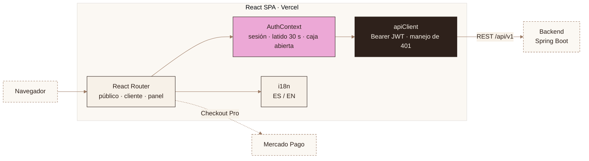
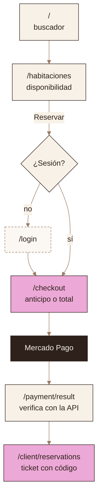
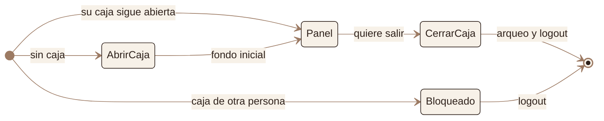
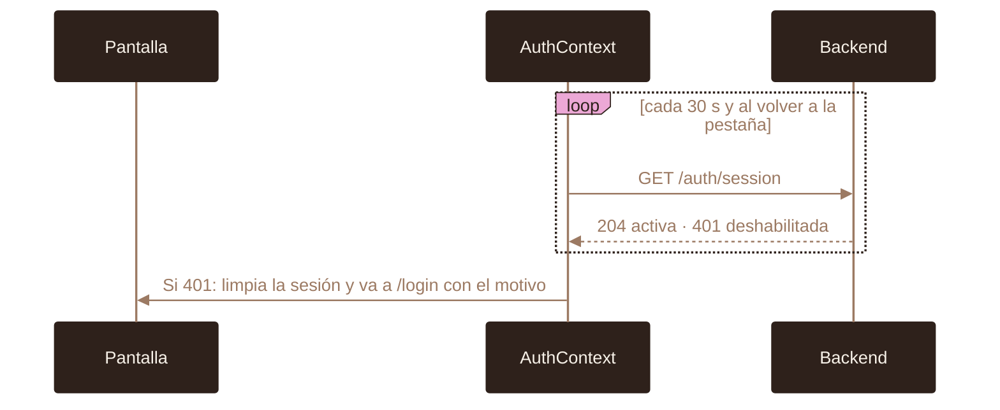
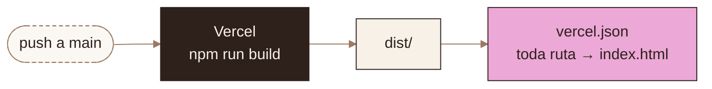

<div align="center">

<h1>Hotel Gotitas · Web</h1>

<p><b>Sitio público, área de cliente y panel de gestión</b><br>
reserva en línea · pago con Mercado Pago · recepción y caja</p>

     

<p>
<a href="#arquitectura">Arquitectura</a> ·
<a href="#flujos">Flujos</a> ·
<a href="#inicio-rápido">Inicio rápido</a> ·
<a href="#rutas">Rutas</a> ·
<a href="https://github.com/HotelGotitass/Hotel">Backend ↗</a>
</p>

</div>

---

## En un vistazo

<table>
<tr>
<td width="33%" valign="top"><b>Sitio público</b><br><sub>Buscador tipo ticket, disponibilidad con comodidades y checkout con anticipo (50 %) o pago total por Mercado Pago.</sub></td>
<td width="33%" valign="top"><b>Área de cliente</b><br><sub>Mis reservas con código, cuenta regresiva para pagar, saldo, cambio de fechas, cancelación y comprobante PDF.</sub></td>
<td width="33%" valign="top"><b>Panel de gestión</b><br><sub>Recepción y cobros, caja obligatoria, facturación simulada, reembolsos, catálogo y personal.</sub></td>
</tr>
</table>

**Diseño** · editorial, espresso y marfil con acento rosa `#ECA8D6`; *Cormorant Garamond* para titulares e *Inter*
para texto. El motivo de **ticket** (bordes perforados, código de reserva) une buscador, checkout y mis reservas.

## Arquitectura



## Flujos

### Reserva y pago del cliente



### Panel del recepcionista

La caja manda: sin caja abierta no hay panel, y con caja abierta no hay cierre de sesión.



<details>
<summary><b>Sesión y expulsión inmediata</b></summary>



</details>

## Inicio rápido

| Requisito | Versión |
|:--|:--|
| Node.js | 18 o superior |
| Backend | en ejecución ([instrucciones](https://github.com/HotelGotitass/Hotel#inicio-rápido)) |

```bash
npm install
cp .env.example .env      # ajusta VITE_API_BASE_URL si hace falta
npm run dev               # http://localhost:5173
```

## Configuración

El frontend **no contiene credenciales**: solo la URL pública del backend.
Plantilla: [`.env.example`](.env.example). Los `.env` reales están en `.gitignore`.

<!-- AUTO-GENERATED: variables de entorno (fuente: .env.example) - no editar a mano -->
| Variable | Descripción | Ejemplo |
|:--|:--|:--|
| `VITE_API_BASE_URL` | URL de la API | `http://localhost:8080/api/v1` |
<!-- /AUTO-GENERATED -->

## Scripts

<!-- AUTO-GENERATED: scripts (fuente: package.json) - no editar a mano -->
| Comando | Qué hace |
|:--|:--|
| `npm run dev` | Servidor de desarrollo · http://localhost:5173 |
| `npm run build` | Build de producción en `dist/` |
| `npm run lint` | ESLint |
| `npm run preview` | Sirve el build localmente |
<!-- /AUTO-GENERATED -->

## Rutas

28 pantallas, protegidas por rol en el cliente y validadas de nuevo en el backend.

<!-- AUTO-GENERATED: rutas (fuente: src/App.jsx) - no editar a mano -->
<details>
<summary><b>Sitio público <sub>· 10 rutas</sub></b></summary>

| Ruta | Pantalla | Acceso |
|:--|:--|:--|
| `/` | Inicio · buscador y habitaciones destacadas | Público |
| `/habitaciones` | Disponibilidad por fechas y huéspedes | Público |
| `/login` | Inicio de sesión | Público |
| `/register` | Registro de cliente | Público |
| `/verify-otp` | Verificación OTP | Público |
| `/forgot-password` | Recuperar contraseña | Público |
| `/reset-password` | Nueva contraseña | Público |
| `/terminos` | Términos | Público |
| `/privacidad` | Privacidad | Público |
| `/libro-reclamaciones` | Libro de reclamaciones | Público |

</details>

<details>
<summary><b>Área de cliente <sub>· 4 rutas</sub></b></summary>

| Ruta | Pantalla | Acceso |
|:--|:--|:--|
| `/checkout` | Confirmación y pago | CLIENT |
| `/client/reservations` | Mis reservas | CLIENT |
| `/client/profile` | Mis datos | CLIENT |
| `/payment/result` | Retorno de Mercado Pago | CLIENT |

</details>

<details>
<summary><b>Panel de gestión <sub>· 14 rutas</sub></b></summary>

| Ruta | Pantalla | Acceso |
|:--|:--|:--|
| `/admin/dashboard` | Indicadores | ADMIN · RECEP. |
| `/admin/recepcion` | Búsqueda por código y cobros | ADMIN · RECEP. |
| `/admin/reembolsos` | Reembolsos | ADMIN · RECEP. |
| `/admin/habitaciones` | Habitaciones | ADMIN |
| `/admin/categorias` | Categorías | ADMIN |
| `/admin/huespedes` | Huéspedes | ADMIN · RECEP. |
| `/admin/reservas` | Reservas y check-in/out | ADMIN · RECEP. |
| `/admin/servicios` | Servicios extra | ADMIN · RECEP. |
| `/admin/facturas` | Facturación simulada | ADMIN · RECEP. |
| `/admin/personal` | Personal y cuentas | ADMIN |
| `/admin/comodidades` | Comodidades | ADMIN |
| `/admin/reclamaciones` | Reclamaciones | ADMIN · RECEP. |
| `/admin/caja` | Caja e historial | ADMIN · RECEP. |
| `/admin/cuenta` | Mi cuenta | ADMIN · RECEP. |

</details>
<!-- /AUTO-GENERATED -->

## Estructura

```text
src/
├── components/         Navbar, Hero, BookingBar, habitaciones, footer
│   └── admin/          CashGate (apertura de caja), PaymentModal
├── pages/              Landing y Habitaciones
│   ├── auth/           Login, registro, OTP, recuperación
│   ├── client/         Checkout, resultado de pago, mis reservas, perfil
│   └── admin/          Panel de administración y recepción
├── context/            AuthContext · sesión, latido, bloqueo de salida
├── utils/              apiClient, pagos, PDFs, íconos de comodidades
└── i18n.js             Traducciones ES / EN
```

## Despliegue



Configura `VITE_API_BASE_URL` en las variables del proyecto en Vercel.
