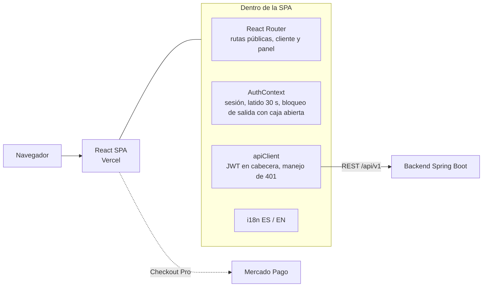
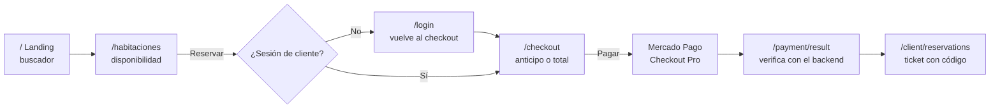
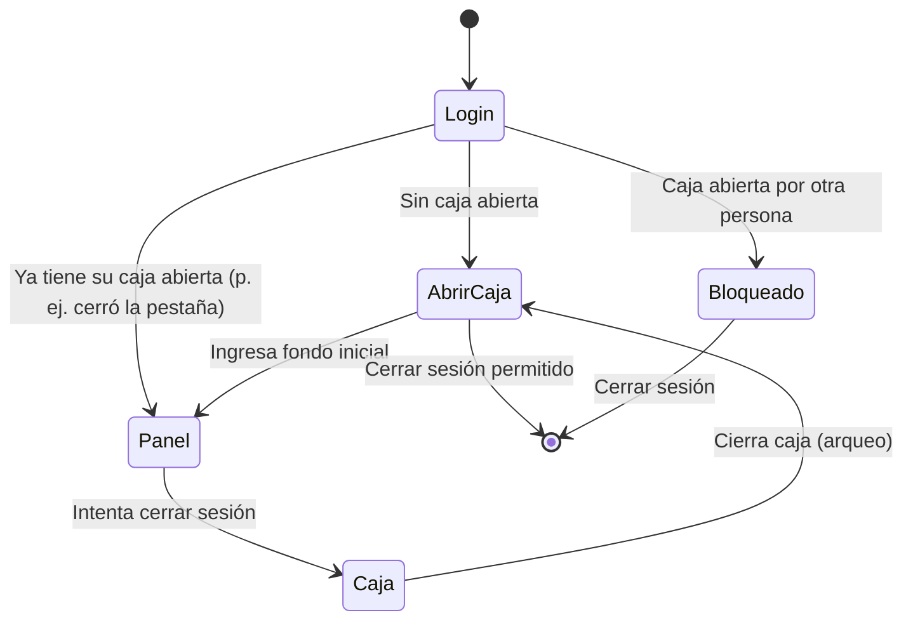
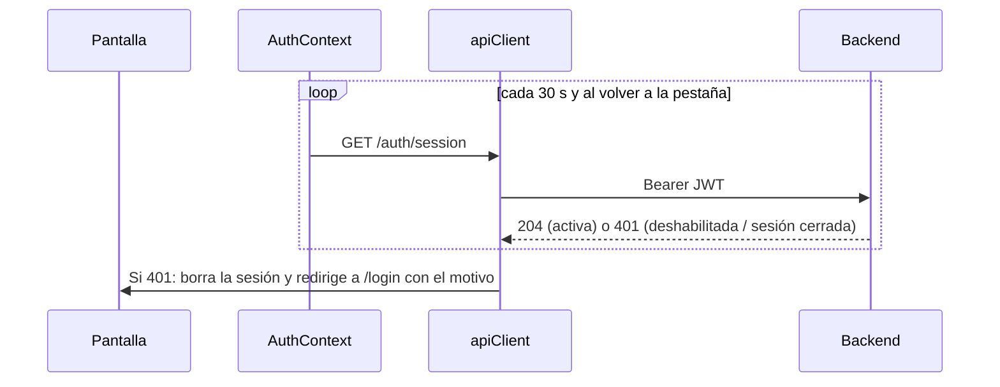
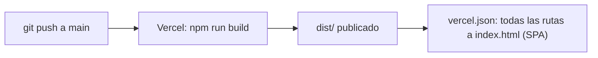

# Hotel Gotitas · Frontend

Sitio web y panel de gestión de **Hotel Gotitas** (una sola sede): reservas en línea con pago por Mercado Pago,
área de cliente y panel para administración y recepción.

> Backend: [HotelGotitass/Hotel](https://github.com/HotelGotitass/Hotel)

## Contenido

- [Stack](#stack) · [Arquitectura](#arquitectura) · [Funcionalidades](#funcionalidades) · [Flujos](#flujos)
- [Rutas](#rutas) · [Variables de entorno](#variables-de-entorno) · [Scripts](#scripts) · [Ejecutar en local](#ejecutar-en-local) · [Despliegue](#despliegue)

## Stack

- React 18 · Vite 5 · React Router 7
- Tailwind CSS 3 (diseño editorial: espresso/marfil, acento rosa, Cormorant Garamond + Inter)
- i18next (español / inglés) · lucide-react (íconos)

## Arquitectura



## Funcionalidades

**Sitio público**: landing con buscador, búsqueda por fechas y huéspedes con comodidades, checkout con anticipo o pago total por **Mercado Pago**.

**Área de cliente**: mis reservas (ticket con código), cuenta regresiva para pagar, pago de saldo, cambio de fechas, cancelación y comprobante PDF.

**Panel**: recepción y cobros, **caja** obligatoria para recepcionistas, facturación simulada, reembolsos, reservas,
huéspedes, catálogo con selector de íconos, personal (deshabilitar cuentas) y mi cuenta.

## Flujos

### Reserva y pago del cliente



### Panel del recepcionista



### Sesión y expulsión inmediata



## Rutas

<!-- AUTO-GENERATED: rutas (fuente: src/App.jsx) - no editar a mano; regenerar desde el codigo -->
| Ruta | Pantalla | Acceso | Descripción |
|---|---|---|---|
| `/` | `Landing` | Público | Inicio: buscador, habitaciones destacadas, reglas de reserva |
| `/habitaciones` | `HabitacionesPage` | Público | Búsqueda de disponibilidad |
| `/login` | `Login` | Público | Inicio de sesión |
| `/register` | `Register` | Público | Registro de cliente |
| `/verify-otp` | `VerifyOtp` | Público | Verificación por código OTP |
| `/forgot-password` | `ForgotPassword` | Público | Recuperar contraseña |
| `/reset-password` | `ResetPassword` | Público | Nueva contraseña |
| `/terminos` | `Terms` | Público | Términos y condiciones |
| `/privacidad` | `Privacy` | Público | Política de privacidad |
| `/libro-reclamaciones` | `ComplaintsBook` | Público | Libro de reclamaciones |
| `/checkout` | `Checkout` | CLIENT | Confirmación y pago |
| `/client/reservations` | `ClientReservations` | CLIENT | Mis reservas |
| `/client/profile` | `ClientProfile` | CLIENT | Mis datos |
| `/payment/result` | `PaymentResult` | CLIENT | Resultado del pago (retorno de Mercado Pago) |
| `/admin/dashboard` | `Dashboard` | ADMIN, RECEPCIONISTA | Indicadores |
| `/admin/recepcion` | `Reception` | ADMIN, RECEPCIONISTA | Búsqueda por código y cobros |
| `/admin/reembolsos` | `Refunds` | ADMIN, RECEPCIONISTA | Reembolsos |
| `/admin/habitaciones` | `Rooms` | ADMIN | Habitaciones |
| `/admin/categorias` | `RoomCategories` | ADMIN | Categorías |
| `/admin/huespedes` | `Guests` | ADMIN, RECEPCIONISTA | Huéspedes |
| `/admin/reservas` | `Reservations` | ADMIN, RECEPCIONISTA | Reservas, check-in/out |
| `/admin/servicios` | `ExtraServices` | ADMIN, RECEPCIONISTA | Servicios extra |
| `/admin/facturas` | `Invoices` | ADMIN, RECEPCIONISTA | Facturación simulada |
| `/admin/personal` | `Employees` | ADMIN | Personal y cuentas |
| `/admin/comodidades` | `Amenities` | ADMIN | Comodidades |
| `/admin/reclamaciones` | `Complaints` | ADMIN, RECEPCIONISTA | Reclamaciones |
| `/admin/caja` | `CashRegister` | ADMIN, RECEPCIONISTA | Caja: movimientos, cierre e historial |
| `/admin/cuenta` | `Account` | ADMIN, RECEPCIONISTA | Mi cuenta |
<!-- /AUTO-GENERATED -->

## Variables de entorno

El frontend **no contiene credenciales**: solo la URL pública del backend.
Plantilla: [`.env.example`](.env.example) (los `.env` reales están en `.gitignore`).

<!-- AUTO-GENERATED: variables de entorno (fuente: .env.example) - no editar a mano; regenerar desde el codigo -->
| Variable | Descripción | Ejemplo |
|---|---|---|
| `VITE_API_BASE_URL` | URL de la API del backend | `http://localhost:8080/api/v1` |
| `VITE_DEPOSIT_PERCENTAGE` | Porcentaje de anticipo mostrado en el checkout (debe coincidir con el backend) | `50` |
<!-- /AUTO-GENERATED -->

## Scripts

<!-- AUTO-GENERATED: scripts (fuente: package.json) - no editar a mano; regenerar desde el codigo -->
| Comando | Descripción |
|---|---|
| `npm run dev` | Servidor de desarrollo con recarga en caliente (http://localhost:5173) |
| `npm run build` | Build de producción en `dist/` |
| `npm run lint` | Análisis estático con ESLint |
| `npm run preview` | Sirve localmente el build de producción |
<!-- /AUTO-GENERATED -->

## Ejecutar en local

Requisitos: **Node.js 18+** y el backend en ejecución.

```bash
npm install
cp .env.example .env      # ajusta VITE_API_BASE_URL si hace falta
npm run dev
```

## Estructura

```
src/
  components/        Navbar, Hero, BookingBar, habitaciones, footer
  components/admin/  CashGate (apertura de caja), PaymentModal
  pages/             Landing y Habitaciones
  pages/auth/        Login, registro, OTP, recuperación de contraseña
  pages/client/      Checkout, resultado de pago, mis reservas, perfil
  pages/admin/       Panel de administración y recepción
  context/           AuthContext
  utils/             apiClient, pagos, descargas de PDF, íconos de comodidades
  i18n.js            Traducciones ES / EN
```

## Despliegue



Configura `VITE_API_BASE_URL` en las variables de entorno del proyecto en Vercel.
